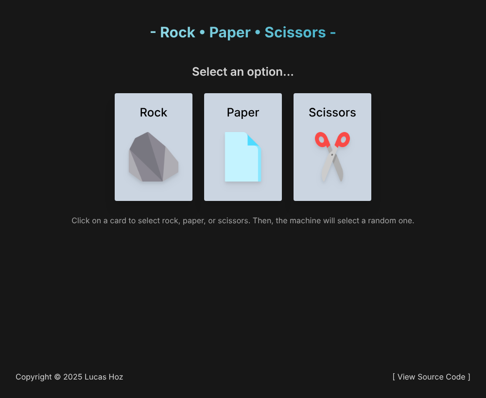
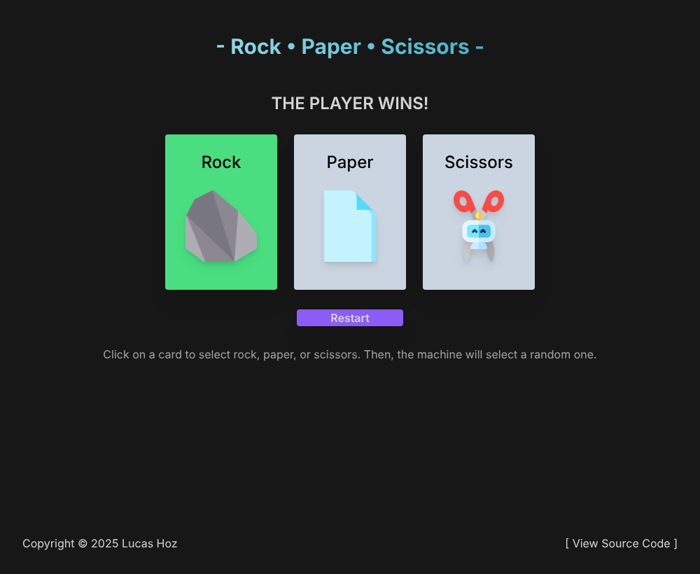
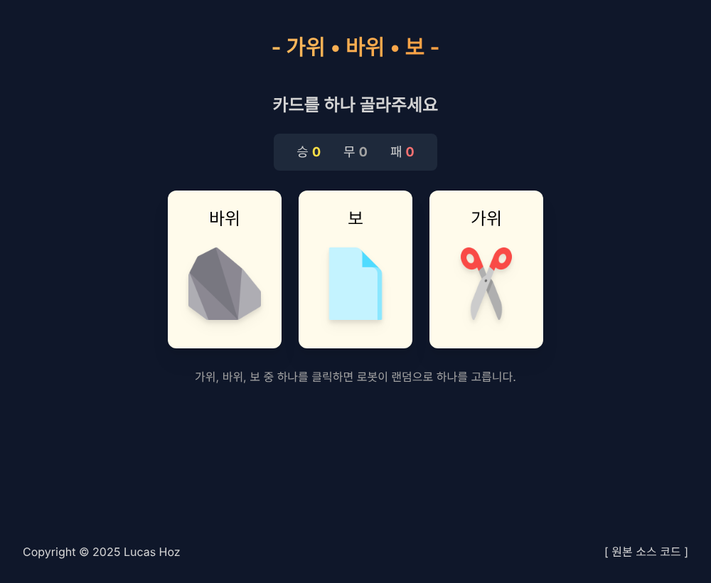
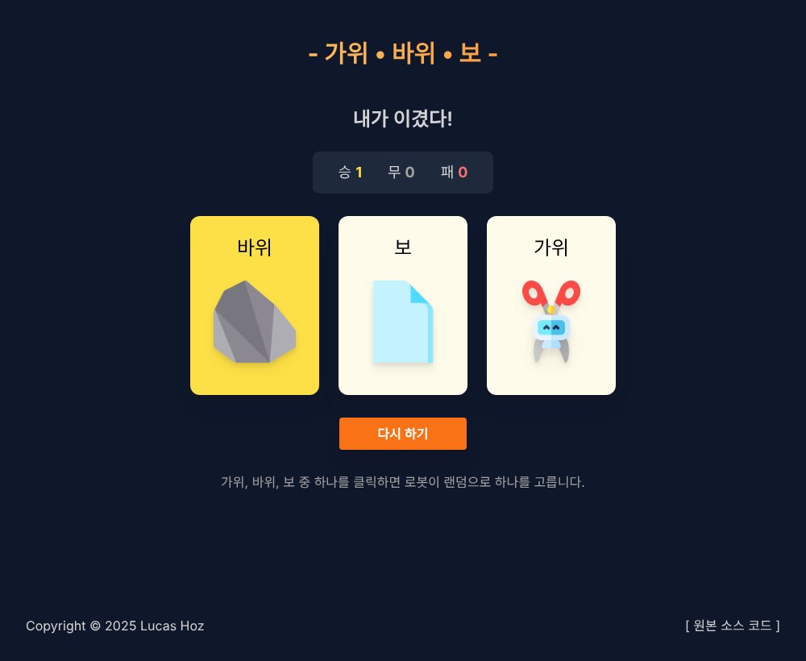
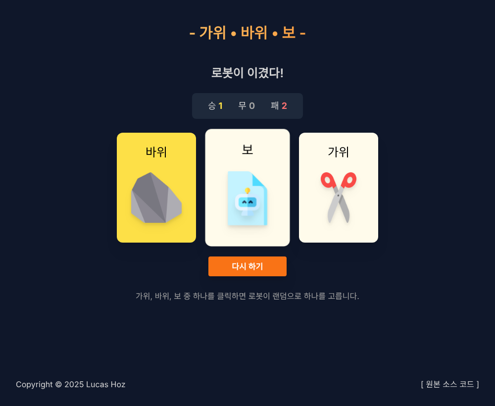

# 가위바위보 vs 로봇 게임

## 1. Project Information

### 프로젝트 소개
React와 Tailwind CSS 기반으로 제작된 싱글 플레이어 가위바위보 vs 로봇 게임 웹 애플리케이션이다. 사용자가 가위, 바위, 보 중 하나를 선택하면 로봇이 무작위로 카드를 선택하고, 두 선택을 비교하여 승패를 결정한다.

### 선택 이유
1. 다른 사람들과 겹치지 않으면서 재미있게 커스터마이징할 수 있는 프로젝트를 찾고 있었다.
2. 코드 구조가 비교적 깔끔하여 React 컴포넌트 구조를 이해하고 UI 요소 추가 및 스타일 변경을 실습하기에 적합하다고 판단했다.

### 주요 기능
1. 가위, 바위, 보 중 하나를 클릭하여 로봇과 대결을 진행한다.
2. 로봇이 무작위로 선택한 카드에 로봇 아이콘을 표시한다.
3. 대결 결과(승/무/패)를 판정하고 결과 메시지를 출력하며, 다시 하기 버튼으로 새로운 게임을 시작할 수 있다.

### 원본 GitHub URL
https://github.com/hozlucas28/Codo-Codo-React-Project-01-2023

### 라이선스
MIT License

원본 프로젝트의 LICENSE 파일과 원작자 Lucas Hoz의 저작권 표시를 유지하였다.

---

## 2. Installation

### 설치 및 실행 방법

1. 저장소 클론

```bash
git clone https://github.com/2026-2-OSS/assign10-c01-22500326.git
```

2. 프로젝트 폴더 이동

```bash
cd assign10-c01-22500326
```

3. 의존성 패키지 설치

```bash
npm install
```

4. 개발 서버 실행

```bash
npm run dev
```

5. 터미널에 표시되는 Local 주소로 접속하여 게임을 실행한다.

### 실행 화면

**원본 프로젝트**





---

## 3. Source Code Exploration

### 주요 파일

- `src/main.jsx`: React 애플리케이션의 진입점으로, App 컴포넌트를 HTML의 root 요소에 렌더링한다.
- `src/App.jsx`: 전체 화면을 구성하고 플레이어 선택, 로봇 선택 등의 게임 상태를 관리한다. 커스터마이징 이후에는 승/무/패 점수를 저장하는 score 상태도 추가하였다.
- `src/constants/TEXTS.js`: 화면에 표시되는 제목, 카드 이름, 안내 문구, 결과 메시지 등의 텍스트 데이터를 한곳에서 관리한다.

### 주요 컴포넌트

- `src/components/Options.jsx`: 가위, 바위, 보 세 개의 선택 카드와 다시 하기 버튼을 포함하는 레이아웃 컴포넌트이다.
- `src/components/Option.jsx`: 개별 카드의 화면 표시와 선택 기능을 담당한다. 사용자의 선택을 부모 컴포넌트로 전달하며, 로봇이 선택한 카드 위에 로봇 아이콘을 표시한다.

### 코드 동작 원리 (getWinner.js)

```javascript
export function getWinner({ firstOpt, secondOpt }) {
    firstOpt = firstOpt.toLowerCase()
    secondOpt = secondOpt.toLowerCase()

    const playerWins = {
        rock: 'scissors',
        paper: 'rock',
        scissors: 'paper',
    }

    if (firstOpt === secondOpt) {
        return 'draw'
    }

    return playerWins[firstOpt] === secondOpt ? 'playerWins' : 'machineWins'
}
```

이 함수는 플레이어와 로봇이 선택한 두 카드를 비교하여 게임 결과를 반환한다. 먼저 두 선택값을 소문자로 변환하여 비교할 수 있는 형태로 맞춘다. 이후 playerWins 객체를 통해 각 카드가 어떤 카드를 이기는지 확인한다.

두 선택이 같으면 무승부인 'draw'를 반환한다. 두 선택이 다르면 playerWins 객체에서 플레이어가 선택한 카드의 승리 조건을 확인한다. 이 값과 로봇의 선택이 같으면 'playerWins'를 반환하고, 그렇지 않으면 'machineWins'를 반환한다.

반환된 결과는 SubHeader.jsx에서 TEXTS.subHeader의 해당 항목을 찾는 데 사용되며, 최종적으로 화면에 승리, 패배 또는 무승부 메시지가 표시된다.

---

## 4. Customizing

기존 프로젝트의 주요 기능을 유지하면서 Text, Style, UI/Data 세 가지 유형의 커스터마이징을 진행하였다.

### 1) Text

**수정 파일**
- `src/constants/TEXTS.js`
- `index.html`
- `src/components/Option.jsx`

**변경 내용**

- 게임 제목과 안내 문구, 카드 이름, 결과 메시지, 버튼 이름 등 기존 영어 텍스트를 한국어로 변경하였다.
- HTML 문서의 언어 설정을 `en`에서 `ko`로 변경하고 브라우저 탭 제목도 한국어로 변경하였다.
- Option.jsx에서 로봇 선택 여부를 확인하는 비교 방식을 수정하였다.
- 로봇 이미지의 alt 속성도 한국어로 변경하였다.

기존에는 카드에 표시되는 영어 이름을 소문자로 변환하여 로봇의 선택값과 비교하였다. 하지만 카드 이름을 한국어로 변경하면서 비교가 정상적으로 작동하지 않는 문제가 발생하였다. 이를 해결하기 위해 화면에 표시되는 텍스트 대신 고정된 value 값을 기준으로 비교하도록 수정하였다.

### 2) Style

**수정 파일**
- `src/index.css`
- `src/components/Header.module.css`
- `src/components/Option.module.css`
- `src/components/RestartBtn.module.css`

**변경 내용**

- 전체 배경색을 검정 계열에서 남색 계열로 변경하였다.
- 게임 제목의 그라데이션을 기존 하늘색에서 노란색과 주황색 조합으로 변경하였다.
- 카드 배경을 회색에서 아이보리색으로 변경하고 모서리를 더 둥글게 수정하였다.
- 선택된 카드의 색상을 초록색에서 노란색으로 변경하였다.
- 다시 하기 버튼을 보라색에서 주황색으로 변경하고 버튼 높이와 글자 색상도 조정하였다.

전체적으로 기존 디자인보다 따뜻하고 밝은 색상을 활용하여 화면의 통일감을 높였다.

### 3) UI/Data

**수정 및 추가 파일**
- `src/App.jsx`
- `src/components/Scoreboard.jsx` (신규)
- `src/components/Scoreboard.module.css` (신규)
- `src/constants/TEXTS.js`

**변경 내용**

기존 프로젝트에는 게임 결과를 누적해서 기록하는 기능이 없었다. 이를 개선하기 위해 승리, 무승부, 패배 횟수를 표시하는 점수판을 새롭게 추가하였다.

- Scoreboard.jsx: 승/무/패 점수를 화면에 표시하는 컴포넌트 추가
- Scoreboard.module.css: 점수판의 배경과 각 점수의 색상을 지정
- TEXTS.js: 점수판에 사용할 승, 무, 패 텍스트 추가
- App.jsx: score 상태를 추가하여 게임 결과에 따라 점수를 누적하도록 수정

또한 기존에는 로봇의 선택값인 machineOpt가 컴포넌트가 렌더링될 때마다 새롭게 결정되는 구조였다. 점수판을 추가하면서 점수가 변경될 때마다 화면이 다시 렌더링되고, 이 과정에서 로봇의 선택이 바뀌어 실제 결과와 점수판이 일치하지 않는 문제가 발생할 수 있었다.

이를 해결하기 위해 machineOpt를 useState로 관리하도록 변경하였다. 사용자가 카드를 선택하는 순간 로봇의 선택을 한 번만 결정하고 상태에 저장하여 화면이 다시 렌더링되어도 해당 판의 결과가 유지되도록 수정하였다.

다시 하기 버튼을 누르면 현재 선택만 초기화하고 누적 점수는 유지하도록 구현하였다.

### 커스터마이징 전후 비교

**수정 후 게임 시작 화면**



**수정 후 게임 진행 화면**



**점수판 확인 화면**



---

## 5. Deployment

Vercel을 이용하여 프로젝트를 배포하였다.

- 배포 방식: GitHub 연동 및 자동 배포(Auto Deploy)
- 배포용 GitHub 저장소: https://github.com/bang20060225-source/22500326_assign10
- 제출용 GitHub 저장소: https://github.com/2026-2-OSS/assign10-c01-22500326

두 저장소를 Git Remote로 연결하여 동일한 코드를 각각 Push할 수 있도록 구성하였다. Vercel은 개인 GitHub 저장소와 연결하여 배포하였다.

**Vercel Production URL:** [https://22500326-assign10.vercel.app/]

---

## 6. Weekly Review

### 새롭게 배운 내용

1. React의 useState를 활용하여 사용자의 선택과 게임 결과, 누적 점수 등의 데이터를 관리하는 방법을 배웠다.
2. 컴포넌트를 기능별로 분리하면 새로운 UI 요소를 추가하거나 기존 코드를 수정하기 편리하다는 점을 알게 되었다.
3. Git Remote를 여러 개 설정하여 하나의 로컬 프로젝트를 여러 GitHub 저장소에 Push할 수 있고, Vercel과 GitHub를 연결하면 자동으로 배포할 수 있다는 점을 배웠다.

### 어려웠던 점과 해결 방법

처음에는 Drum Machine 프로젝트를 선택했지만, 외부 서버에서 음원 파일을 불러오는 과정에서 소리가 정상적으로 재생되지 않는 문제가 발생하였다. 외부 의존성이 적은 프로젝트를 선택하는 것이 좋다고 판단하여 가위바위보 게임으로 변경하였다.

한국어 커스터마이징 과정에서는 카드 이름을 변경한 뒤 로봇 아이콘이 표시되지 않는 문제가 발생하였다. 기존 코드가 영어 카드 이름을 기준으로 로봇의 선택과 비교하고 있었기 때문에, 화면에 표시되는 텍스트가 아닌 고정된 value 값을 비교하도록 수정하여 해결하였다.

또한 점수판을 추가한 뒤 화면이 다시 렌더링될 때 로봇의 선택이 바뀌는 문제를 발견하였다. machineOpt를 useState로 관리하도록 변경하여 한 판의 선택 결과가 유지되도록 해결하였다.

배포 과정에서는 Vercel 무료 플랜에서 Organization의 Private 저장소를 바로 연결할 수 없는 문제가 있었다. 개인 GitHub 저장소를 별도로 연결하고 두 저장소에 모두 Push하는 방식으로 해결하였다.

### AI 활용 내용 및 느낀 점

프로젝트의 코드 이해와 커스터마이징 과정에서 Claude를 활용하였다. 새로운 점수판 컴포넌트 작성, 기존 코드 수정, 오류 원인 파악 등에 도움을 받았다.

AI가 제안한 코드를 그대로 사용하는 것보다는 실제 프로젝트에 적용한 뒤 실행 결과를 확인하고, 문제가 발생하면 코드를 다시 분석하고 수정하는 과정이 중요하다는 것을 느꼈다. 특히 한국어 변경 이후 로봇 아이콘이 사라지는 문제와 점수판 추가 이후 로봇 선택이 바뀌는 문제를 해결하면서 코드의 동작 원리를 이해하는 것이 중요하다는 점을 배웠다.

이번 과제를 통해 단순히 기존 프로젝트의 디자인을 변경하는 것뿐만 아니라 React의 상태 관리와 컴포넌트 구조를 이해하고, GitHub와 Vercel을 활용하여 실제 웹사이트로 배포하는 과정까지 경험할 수 있었다.